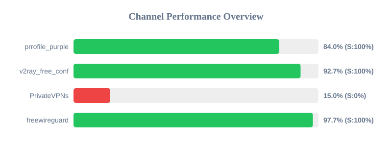

# 🌟 Proxy Channel Performance Dashboard 🌟

_Last Updated: 2026-11-06T10:30:53.901354_

---

## 👩‍💻 Developer Information

- **[GitHub Profile](https://github.com/4n0nymou3)**  
- **[Project Repository](https://github.com/4n0nymou3/multi-proxy-config-fetcher)**  
- **[X (Twitter)](https://x.com/4n0nymou3)**  

---

## 📊 Performance Overview

| Metric                | Value       |
|-----------------------|-------------|
| **Active Channels**   | 3 / 4       |
| **Total Valid Configs** | 32          |
| **Average Success Rate** | 75.0%      |
| **Average Response Time** | 0.45s       |

---

## 📋 Detailed Channel Statistics

| Channel          | Status     | Score  | Success Rate | Response Time | Valid/Total | Last Success               |
|------------------|------------|--------|--------------|---------------|-------------|----------------------------|
| **freewireguard**  | ✅ Active  | 99.1%  | 100.0% | 0.58s         | 15/15       | 2026-11-06T10:30:53.900049 |
| **v2ray_free_conf**  | ✅ Active  | 85.4%  | 100.0% | 0.54s         | 9/20       | 2026-11-06T10:30:41.364659 |
| **prrofile_purple**  | ✅ Active  | 82.3%  | 100.0% | 0.70s         | 8/24       | 2026-11-06T10:30:40.790198 |
| **PrivateVPNs**  | ❌ Inactive  | 15.0%  | 0.0% | 0.00s         | 0/36       | None |

---

### Quick Overview

  

### Detailed Report
📊 [View Full Interactive Dashboard](https://htmlpreview.github.io/?https://github.com/nullluser/NullRepo/blob/main/assets/performance_report.html)

🎉 **All channels are currently active and performing optimally!** 🎉
